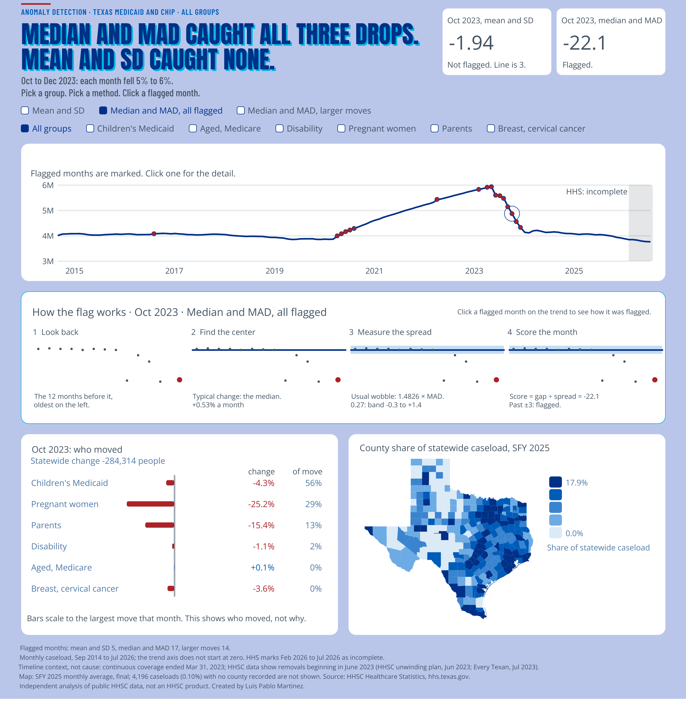

# Saturday Stats

Advanced analytics on public data, built on Saturdays. Each project ends in a dashboard a non-specialist can read in a minute, and the method is always the same: **picture first, then the number.**

| # | Project | Question | Status |
|---|---|---|---|
| 01 | [HHS anomaly detector](projects/01-hhs-anomaly-detector) | Which months of Texas Medicaid and CHIP enrollment are unusual, and does the method matter? | Live on Tableau Public |
| 02 | [School discipline disparities](projects/02-school-discipline-disparities) | Which campuses sit far above expectation, and where are the gaps widest? | Planned |

[](https://public.tableau.com/views/HHSCMedicaidCHIPEnrollment/HHSCAnomalyDetector?:language=en-US&:display_count=n&:origin=viz_share_link)

*Project 01, live on Tableau Public: click the picture to open it.*

## How the projects are built
- **Show uncertainty.** Every estimate carries a band; no bare numbers.
- **Prove each module.** Every analysis step has a test that recomputes it independently (`shared/tests/`).
- **Say what a view cannot say.** Each dashboard states its limits in its footer.
- **Public, aggregated data only.** No secrets, no individual records, no data in git.

## Layout
```
shared/      analysis modules and the output-table contract (tested)
projects/    one folder per project: README, dataset spec, scripts
docs/        the output table, and one-picture concept notes (docs/concepts/)
data/        ignored by git; see data/README.md
```

## Quick start
```bash
python3 -m venv .venv && source .venv/bin/activate
pip install -r requirements.txt
python -m pytest shared
```

## License
MIT (see `LICENSE`). Data belongs to its publishers; each project lists its sources and terms.

## Before you push
```bash
git status                      # no CSVs, shapefiles, fonts, .env or .twb
git grep -n -i "sk-ant\|api_key\|password"   # should print nothing
```
