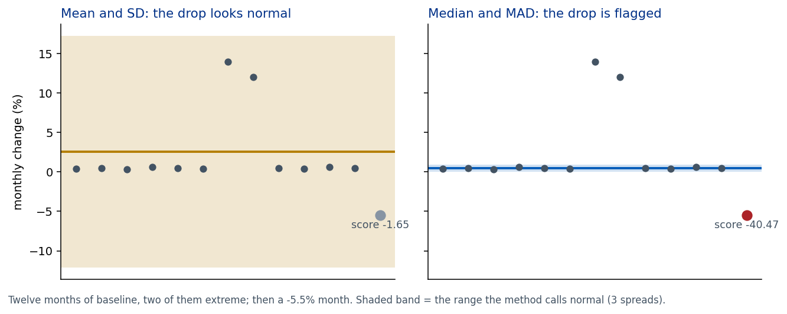

# 01 Median vs mean

1. Two extreme months in the baseline stretch the standard deviation, so the mean-and-SD band grows wide enough to swallow a real drop; the median and MAD barely notice the extremes.
2. If you only used mean and SD, you would call that month normal and look elsewhere.
3. The median and MAD yardstick can flag too much when a baseline is very quiet, which is why the HHS project also reports a "larger moves" rule with a minimum gap.

Check: score -1.65 with mean and SD, about -40 with median and MAD (see `shared/tests/test_flagging.py`).
